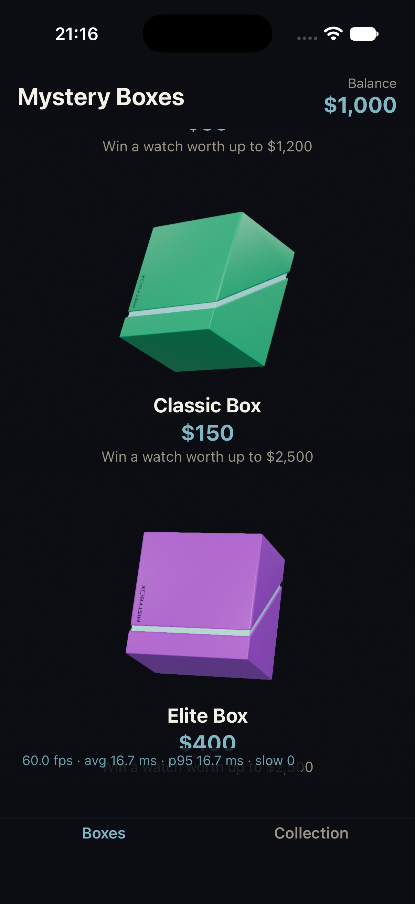
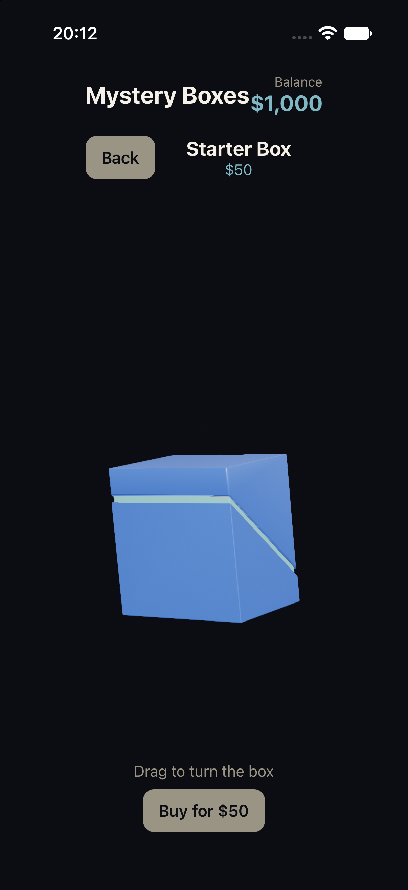
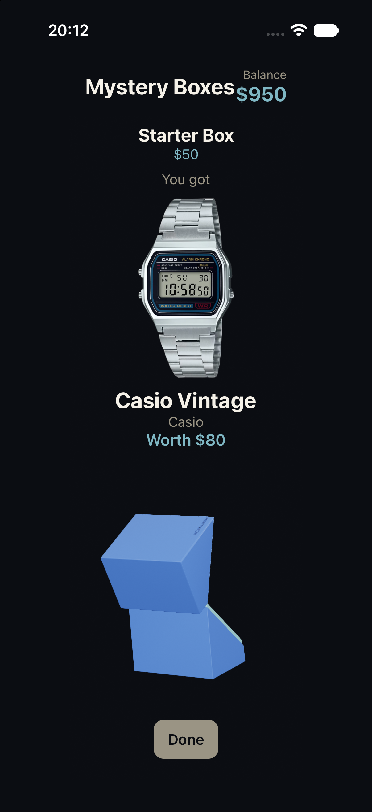
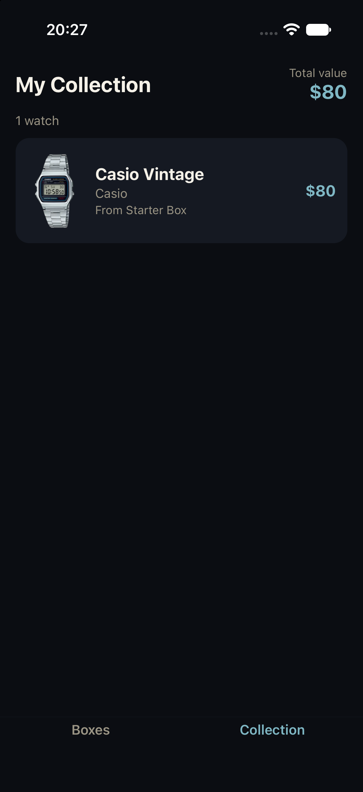
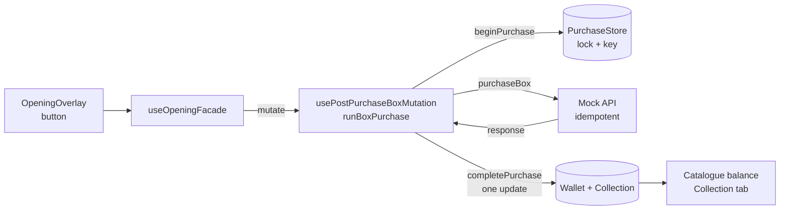
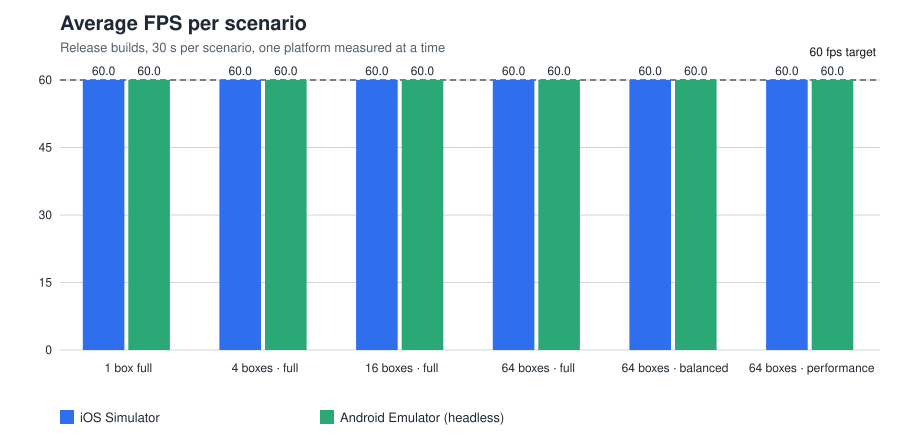

# `Mystery Watch` - React Native Proof of Concept

[](https://expo.dev/)
[](https://reactnative.dev/)
[](https://www.typescriptlang.org/)
[](https://google.github.io/filament/)
[](https://docs.swmansion.com/react-native-reanimated/)
[](https://zustand-demo.pmnd.rs/)
[](https://tanstack.com/query/latest)

## Table of Contents

1. [Introduction](#1-introduction)
2. [Quick Start](#2-quick-start)
3. [The App](#3-the-app)
4. [Project Architecture](#4-project-architecture)
5. [Real-time 3D](#5-real-time-3d)
6. [Vendored Filament](#6-vendored-filament)
7. [Quality Gates and Tests](#7-quality-gates-and-tests)
8. [Performance](#8-performance)
9. [Project Structure](#9-project-structure)
10. [Roadmap & Status](#10-roadmap--status)
11. [Known Limits and Decisions](#11-known-limits-and-decisions)
12. [Troubleshooting](#12-troubleshooting)

---

## 1. Introduction

**Project Overview:**
Mystery Watch is a proof of concept for discovering, buying and opening mystery boxes that contain watches. A scrollable catalogue shows **real-time rendered 3D boxes**, you tap one to **inspect it with your finger and open it** with an animated lid and a reveal, a virtual balance pays for it, and the watches you win go into your collection. The assignment is in [docs/ASSIGNMENT.md](docs/ASSIGNMENT.md).

The code base follows the conventions of an enterprise React Native app: feature-based **flows**, logic-less UI, **facades** for business logic, **adapters** for data mapping, Zustand for client state and React Query for async (mock-API) state.

**Definition of done — all met on iOS and Android:**
- the full flow works: browse → inspect → buy → open → reveal → collection
- every successful purchase makes **exactly one balance deduction and one watch** (also under repeated taps and lost responses)
- a failed purchase **changes nothing** (balance and collection stay the same) and can be retried
- the 3D scene holds **60 FPS** while scrolling, turning and opening

**Key Features:**

- 🧊 Real-time 3D with **Google Filament** (Metal on iOS, OpenGL ES on Android), driven from worklets
- 🎯 **One shared 3D scene** for the whole app — the same box models are in the list and in the opening screen
- 🔩 Exact **hinge kinematics** for the lid and wordmark (pivot `[0, 0.914876, 0.359181]`, 0° → 115°)
- ✋ **Drag to inspect** with inertia, animated lid with a small "pop", watch reveal, haptics
- 💸 Purchase with an **exactly-once guarantee** (idempotency keys, atomic state update, lock against repeated taps)
- 🏗️ Feature-based (flows) architecture, facades, adapters, typed navigation
- 🔄 Zustand (session-scoped, no persistence) + React Query over an asynchronous mock API with a failure switch
- 🧪 Jest + React Native Testing Library, ESLint 9 + Prettier, `ciPipeline`
- 📦 **Vendored** 3D dependency with a reproducible binary installer — builds on a clean machine
- 📊 Reproducible performance tooling and a plain-English [performance report](docs/PERFORMANCE.md)

**Tech Stack:**

| Area | Choice |
|---|---|
| Framework | Expo SDK 58, React Native 0.88.1 (new architecture), React 19.3 |
| Language | TypeScript 6.0 (strict) |
| 3D | `react-native-filament` 2.0.0-rc.6 (vendored) |
| Animation / gestures | Reanimated 4.7 + `react-native-worklets` 0.13, Gesture Handler 3, Haptics |
| State | Zustand 5 (client), TanStack Query 5 (mock API) |
| Navigation | React Navigation 7 (bottom tabs) |
| Lists | FlashList 2 |
| i18n | i18next 27 |
| Tests | Jest 30 + React Native Testing Library 14 |
| Quality | ESLint 9 (flat) + Prettier 3, `expo-doctor` |

---

## 2. Quick Start

### Prerequisites

- macOS with **Xcode 27** and an iOS Simulator (Xcode 27 requires Expo SDK 58+)
- **Android Studio**, JDK 17, an AVD with **≥ 4 cores, ≥ 4 GB RAM, `hw.gpu.mode=host`**
- Node 24+ (developed on Node 26), yarn classic 1.22 (`corepack enable`), CocoaPods, watchman
- `export LANG=en_US.UTF-8` (CocoaPods needs a UTF-8 locale)

### Installation and first run

```bash
git clone https://github.com/GoRRRuslan/boxConceptOfProof-1
cd boxConceptOfProof-1

# Install dependencies. The postinstall hook downloads the Filament native
# binaries once (~90 MB archive, cached in .cache/filament) into node_modules.
yarn install

# Generate the native projects
yarn iosPrebuild
yarn androidPrebuild

# Build and install the development client, then start Metro
yarn iosRun            # iPhone simulator
yarn androidRun        # Android emulator / device
yarn start
```

> Expo Go cannot run Filament — the app is a **development build** (`expo-dev-client`).

### Run the quality gates

```bash
yarn ciPipeline   # ESLint + TypeScript
yarn test         # Jest + React Native Testing Library
```

### Release builds (what the performance numbers use)

```bash
yarn androidEmulatorStart                 # Android emulator, headless (needed for correct FPS)
yarn androidRunOpening                    # release build with the FPS overlay
yarn iosRunOpening --device "iPhone 17"   # same on iOS
```

### Scripts

| Script | What it does |
|---|---|
| `yarn start` | Metro for the development client |
| `yarn iosPrebuild` / `yarn androidPrebuild` | Clean native project generation (`expo prebuild --clean`) |
| `yarn iosRun` / `yarn androidRun` | Build and install the development client |
| `yarn ciPipeline` | **ESLint + TypeScript** (the gate for every change) |
| `yarn test` | Jest + RNTL |
| `yarn doctor` | `expo-doctor` health check |
| `yarn adbR` | `adb reverse tcp:8081 tcp:8081` |
| `yarn cleanNative` / `cleanCache` / `cleanNode` / `watchman` | Reset helpers |
| `yarn iosRestart` / `yarn androidRestart` / `yarn androidRestartRelease` | Relaunch the installed app without rebuilding |

The performance scripts are listed in [Performance](#8-performance).

---

## 3. The App

Two tabs: **Boxes** and **Collection**.

| Browse | Inspect | Reveal | Collection |
|---|---|---|---|
|  |  |  |  |

1. **Browse (Boxes tab).** Eight boxes at different prices, each a live 3D model with its own colour. The card shows the price and the best possible prize; a box the balance cannot pay for says "Not enough balance". The balance is in the header.
2. **Inspect.** Tap a box: it flies to the middle of the screen. Drag to turn it (it keeps turning after you let go).
3. **Buy.** One button. While the purchase runs the button is disabled and you cannot leave. On success the balance drops by the price and the watch is yours; on failure you see why ("Nothing was charged") and can try again.
4. **Open.** The lid swings open about its hinge (with a small "pop" and a haptic tap) and the watch image zooms in with its name and value.
5. **Collection tab.** Your watches, newest first, with the total value; an empty state with a "Browse boxes" button when you have none. A restart starts a new session (nothing is persisted, as required).

Detailed write-ups with screenshots, per stage: [Stage 2 domain](docs/STAGE_2_DOMAIN.md) · [Stage 3 catalogue](docs/STAGE_3_CATALOGUE.md) · [Stage 4 opening](docs/STAGE_4_OPENING.md) · [Stage 5 collection](docs/STAGE_5_COLLECTION.md) · [manual test checklist](docs/TEST_CHECKLIST.md).

### The purchase guarantee

Balance and collection change in **one place** — `PurchaseStore.completePurchase` — in a single state update, only when the API succeeded, the response belongs to the running purchase and its idempotency key was not applied before.

| Case | Result |
|---|---|
| Success | one deduction + one watch |
| Not enough balance | refused before the API; nothing changes |
| Network / server error | nothing changes; the next purchase is unlocked |
| Repeated taps while a purchase runs | extra taps ignored (synchronous lock), the API is called once |
| Response lost (server did process it) | the retry re-uses the idempotency key → same watch, still **one** deduction |

The mock API (`src/networking/api/MysteryBoxApi`) is asynchronous (700 ms), idempotent per key, and has a failure switch: `EXPO_PUBLIC_MOCK_PURCHASE_FAILURE=networkError | serverError | responseLost` (or `mockApiSettings` in code and tests).

---

## 4. Project Architecture

### Core Principles

1. **Feature-Based (flows) Architecture:** code is organised by business feature, not by technical layer
2. **Logic-less UI:** screens contain render methods and one `useFacade` call — nothing else
3. **Separation of Concerns:** UI → facade → adapters/stores/queries → services
4. **Typed everywhere:** strict TypeScript, facade return types live in `_types/`
5. **Testability:** business logic is in hooks and pure functions that are unit-tested without rendering

### Architecture Layers

```
┌─────────────────────────────────────┐
│           Presentation Layer        │
│        (Screens & Components)       │
├─────────────────────────────────────┤
│          Business Logic Layer       │
│       (Facades & Facades logic)     │
├─────────────────────────────────────┤
│         Navigation Logic Layer      │
│          (tabs, navigation)         │
├─────────────────────────────────────┤
│              Data Layer             │
│   (Mock API · Zustand · Adapters)   │
├─────────────────────────────────────┤
│           Rendering Layer           │
│   (Filament scene · worklet runtime)│
├─────────────────────────────────────┤
│          Platform (Expo / RN)       │
└─────────────────────────────────────┘
```

### Data flow of a purchase



### Conventions (enforced by ESLint and `CLAUDE.md`)

- No abbreviations in names; English only in code
- No hard-coded visible strings — everything through `t()`
- No logic in UI files; no fallback substitution (guard → warn → return)
- Facade sections in strict order: translations → navigation → state → store → queries/mutations → adapters → values → handlers → effects
- `FlashList` for lists, `testID` on every interactive element, no inline styles or colour literals
- Path aliases: `@app`, `@flows`, `@components`, `@models`, `@networking`, `@services`, `@utils`, `@assets`, `@i18next`, `@configs`, `@navigation`

---

## 5. Real-time 3D

### One scene for the whole app

Each `<FilamentScene>` creates its own Filament engine, and the library is built for **one engine per app**. On Android a second scene never draws. The catalogue is therefore one scene behind a list of transparent cards, and the opening experience reuses the same box instances.

```
┌──────────────── FlashList (transparent cards) ────────────────┐
│  name · price · prize         ← React Native views            │
├───────────────────────────────────────────────────────────────┤
│  ONE FilamentScene (behind the list)                          │
│   box #1   box #2   box #3 …   ← one GLB, instanced           │
└───────────────────────────────────────────────────────────────┘
        ▲ every frame: pose of each box = f(scroll offset, opening state)
```

- On every scroll event the offset is written into a shared value; right before each frame the 3D side reads it and places every box in its card's slot ([`computeBoxPose`](src/flows/catalogueFlow/_facadesLogic/computeBoxPose.ts)). React is not involved per frame.
- When a box is opened, React writes a tiny state (which box, start times, targets); the scene computes the fly-in, the lid angle and the drag inertia by itself ([`computeOpeningPose`](src/flows/openingFlow/_facadesLogic/computeOpeningPose.ts), [`openingSceneState`](src/flows/openingFlow/_facadesLogic/openingSceneState.ts), [`stepDragInertia`](src/flows/openingFlow/_facadesLogic/stepDragInertia.ts)).
- **Render on demand:** the renderer runs while something moves and stops when the scene is still.

### Hinge kinematics

The lid (`Shell_Lid`) and the wordmark (`Shell_Wordmark`) have identity node transforms, so their origins are not hinge pivots. The rotation about the documented pivot `p` is `T(p) · R(θ) · T(−p)`, set as an absolute transform every frame. Pure helpers with unit tests: [`computeLidHingeTransform.ts`](src/services/filament/computeLidHingeTransform.ts).

---

## 6. Vendored Filament

The published `react-native-filament@1.11.0` does not work on React Native 0.88: it depends on `react-native-worklets-core`, which does not compile on iOS (`RCTCxxBridge` was removed) and calls the removed `InteractionManager`. The unreleased **v2 line** runs on `react-native-worklets` (already shipped with Reanimated 4) and removes both problems.

- Source is **vendored** in [`vendor/react-native-filament`](vendor/react-native-filament) (3.9 MB, MIT) — provenance, commit and local changes in [`VENDOR.md`](vendor/react-native-filament/VENDOR.md)
- The ~340 MB prebuilt native binaries are **not committed**; [`scripts/installFilamentBinaries.sh`](scripts/installFilamentBinaries.sh) fetches them from the official npm tarball on `yarn install` (idempotent, cached)
- No source patches; when a stable v2 is published, replace the vendor folder with the npm package

---

## 7. Quality Gates and Tests

```bash
yarn ciPipeline   # eslint . && tsc --noEmit      → must be clean
yarn test         # jest                            → 163 tests, 34 suites
yarn doctor       # expo-doctor
```

| Check | Status |
|---|---|
| ESLint (strict-type-checked, stylistic, react-native, react-hooks) | ✅ clean |
| TypeScript 6 strict | ✅ clean |
| Jest + RNTL | ✅ 163 / 163 |
| Clean clone: install → lint → types → tests | ✅ (see [checklist](docs/TEST_CHECKLIST.md)) |
| Full flow on iOS 27 and Android 37 | ✅ (see [checklist](docs/TEST_CHECKLIST.md)) |

**What the tests cover**

| Area | Tests |
|---|---|
| Purchase rules | store (lock, exactly-once, failure, retry key), mock API (idempotency, latency, failure modes), `runBoxPurchase` end to end (success, no balance, failures, repeated taps, lost response, sequence), the mutation hook |
| Opening | phase machine, easing and progress, scene state, pose maths, drag inertia, primary-button logic, the opening facade end to end (buy → open → reveal → done, failure + retry, unaffordable, back, inertia keeps the renderer busy) |
| Catalogue / collection | pose maths, colour conversion, card and row adapters, both facades, tab labels, collection value |
| UI | `BoxCard`, `OpeningOverlay`, `CatalogueScreen`, `CollectionScreen`, `ScreenHeader`, `AppButton` |
| Render on demand | stop/start rules, restart gap, continuous mode |
| Performance tooling | frame-time summary |

Not unit-tested (verified on devices instead): the worklet scene code that talks to Filament, the FPS meter, the animated reveal.

---

## 8. Performance

**Result: 60 FPS on iOS and Android, 0 slow frames, from 1 to 64 boxes and while scrolling the real catalogue.** Plain-English report with charts, screenshots, methodology and limits: [docs/PERFORMANCE.md](docs/PERFORMANCE.md).



- Frame rate comes from an **in-app renderer FPS meter** (counts Filament's per-frame callbacks), cross-checked with SurfaceFlinger (Android), Instruments (iOS) and Perfetto (Android)
- Implemented: render on demand, GLB instancing, Draco GLB (1.32 MB → 157 KB), WebP watches (−92 %), arm64-only builds, quality profiles
- The Android emulator only reaches 60 FPS **headless** (`yarn androidEmulatorStart`); with its window it is capped at ~24 FPS by its own window compositing. Measure one platform at a time (shared host GPU)

| Command | Purpose |
|---|---|
| `yarn androidEmulatorStart` / `yarn androidEmulatorStop` | Boot / stop the Android emulator **headless** |
| `yarn androidRunCatalogueScroll` / `yarn iosRunCatalogueScroll` | Build a release app whose catalogue scrolls by itself |
| `yarn perfAndroidCatalogue` / `yarn perfIosCatalogue` | Measure FPS while the catalogue scrolls (60 s) |
| `yarn androidRunOpening` + `yarn perfAndroidOpening` | Play the whole opening flow on the emulator, screenshots + FPS |
| `yarn iosRunOpening` | Build a release iOS app with the FPS overlay |
| `yarn androidRunSuite` / `yarn iosRunSuite` | Build a release app that runs the 6-scenario benchmark (box counts × quality) |
| `yarn perfAndroidSuite` / `yarn perfIosSuite` | Restart, collect ~200 s, screenshots, FPS table |
| `yarn perfAndroidPresentFps` | Independent FPS from SurfaceFlinger presented frames |
| `yarn perfIosFps` / `yarn perfAndroidFps` | Quick FPS sample of the running app |
| `yarn perfIosProfile [UDID]` | Instruments Time Profiler → CPU per thread |
| `yarn perfAndroidTrace` | Perfetto 10 s trace → CPU per thread, buffer-queue stalls |
| `yarn perfCharts` | Redraw the SVG charts in `docs/media` from `docs/data` |
| `yarn assetsOptimize` | Re-encode GLB (Draco) and watch images (WebP) from `assets-source/` |

Environment variables (build time): `EXPO_PUBLIC_SHOW_PERFORMANCE=1` (FPS overlay), `EXPO_PUBLIC_AUTO_SCROLL=1`, `EXPO_PUBLIC_INITIAL_SCREEN=spike` (benchmark lab instead of the app), `EXPO_PUBLIC_AUTO_BENCHMARK`, `EXPO_PUBLIC_AUTO_BOXES`, `EXPO_PUBLIC_PERF_SINK_URL`, `EXPO_PUBLIC_MOCK_PURCHASE_FAILURE`, `ANDROID_ARCHITECTURES`. Tip: if a release build seems to use old JavaScript, delete `android/app/build/generated/assets/react` and `intermediates/assets/release`.

---

## 9. Project Structure

```
boxConceptOfProof-1/
├── CLAUDE.md                         # project rules (adapted from the reference app)
├── app.config.ts                     # Expo config (dynamic)
├── babel.config.js · metro.config.js # aliases, worklets plugin, .glb assets
├── eslint.config.mjs · .prettierrc.json
├── docs/                             # ASSIGNMENT, DEVELOPMENT_PLAN, PERFORMANCE, STAGE_*, TEST_CHECKLIST, MODEL
│   ├── media/                        # screenshots and charts
│   └── data/                         # raw measurement logs
├── scripts/
│   ├── installFilamentBinaries.sh
│   ├── app/                          # restart, headless emulator, tap by testID
│   ├── assets/                       # GLB (Draco) and WebP optimisation
│   └── perf/                         # FPS suite, catalogue scroll, opening flow, profilers, charts
├── vendor/react-native-filament/     # vendored 3D engine binding (+ VENDOR.md)
├── __tests__/                        # app-level tests
└── src/
    ├── app/                          # App.tsx, useAppFacade.ts, App.styles.ts
    ├── assets/                       # models/box.glb · images/watches/{full,thumb}/*.webp
    ├── components/                   # ScreenHeader · FadingView · RenderOnDemand · PerformanceOverlay · AppText · buttons/AppButton · _layout/ScreenContainer
    ├── navigation/                   # tab navigator, navigation container + theme
    ├── models/mainStorage/           # WalletStore · CollectionStore · PurchaseStore · _storeConfigured (session-scoped Zustand)
    ├── networking/                   # api/MysteryBoxApi (mock) · requests/{queries,mutations} · errorHandling
    ├── flows/
    │   ├── catalogueFlow/            # 3D catalogue: facade, adapter, pose maths, screen, scene
    │   ├── openingFlow/              # phases, drag, lid, reveal, purchase: facade, logic, overlay
    │   ├── collectionFlow/           # collection tab: facade, adapter, screen
    │   └── spikeFlow/                # benchmark lab (EXPO_PUBLIC_INITIAL_SCREEN=spike)
    ├── i18next/                      # i18init.ts · translations/en.json
    ├── services/                     # filament (hinge maths) · haptics · performance (FPS meter) · reactQuery
    └── utils/                        # designSystem/Theme · formatCurrency · delay · watchImageSources
```

---

## 10. Roadmap & Status

| Stage | Scope | Status |
|---|---|---|
| 0 | Scaffold on Expo SDK 58, reference structure, lint/ts/jest, both platforms running | ✅ done |
| 1 | Filament spike: GLB, lighting, hinge, multi-box strategy, vendoring, performance analysis | ✅ done |
| 2 | Domain, asynchronous mock API, stores, purchase mutation — [docs](docs/STAGE_2_DOMAIN.md) | ✅ done |
| 3 | Live 3D catalogue over one shared canvas — [docs](docs/STAGE_3_CATALOGUE.md) | ✅ done |
| 4 | Opening experience: inspect, buy, lid, reveal, haptics, errors — [docs](docs/STAGE_4_OPENING.md) | ✅ done |
| 5 | Tabs and the collection — [docs](docs/STAGE_5_COLLECTION.md) | ✅ done |
| 6 | Tests, review, manual checklist, final performance run, handoff — [checklist](docs/TEST_CHECKLIST.md) | ✅ done |

---

## 11. Known Limits and Decisions

- **Simulators/emulators only.** All numbers come from the iOS Simulator and the Android Emulator on an Apple M5 Pro; their GPU is much faster than a phone's. The pipeline is proven not to be the bottleneck; physical devices have not been measured yet (the same scripts work on them unchanged).
- **Filament v2 is a release candidate** (vendored and pinned, no source patches).
- **Session-only state:** the balance ($1,000), the collection and the purchase log live in memory; a restart begins a new session.
- **Prize roll is deterministic per purchase key** in the mock (so a retry can never turn into a different watch); the odds come from each box's drop table.
- **Camera and light are fixed;** the opening "dolly" is done by moving and scaling the box.
- Leaving after buying without opening is allowed — the watch is already in the collection.
- Known, accepted review notes: `t` appears in some hook dependency arrays (stable, but against the stated rule); the drag state is written by both the gesture and the render loop without a lock (one lost finger delta at the moment of release at worst).

---

## 12. Troubleshooting

| Symptom | Cause / fix |
|---|---|
| `pod install` fails with *Unicode Normalization not appropriate for ASCII-8BIT* | `export LANG=en_US.UTF-8` |
| iOS app crashes at launch on iOS 27 | Xcode 27 requires the UIScene lifecycle; use **Expo SDK 58+** (this project) |
| `expo run:ios` ends with an osascript error about the *Simulator* window | Xcode 27 ships **DeviceHub.app** instead of Simulator.app. The app is already installed: run `yarn start` and open it (`xcrun simctl launch booted com.gorrr.mysterywatch`) |
| Blank screen on Android after adding navigation | The root container must be `flex: 1` without `alignItems: center` (see `App.styles.ts`) |
| Only the first 3D view renders on Android | Use one `FilamentScene` per app (see [Real-time 3D](#5-real-time-3d)) |
| Android emulator shows ~24 FPS | Start it headless: `yarn androidEmulatorStart` (the window caps it) |
| Android emulator window hangs at start from a script | Use the headless start; the windowed one needs a GUI session |
| Android emulator crawls / UI shows *Updating…* | Use an AVD with ≥ 4 cores / ≥ 4 GB / host GPU; let the post-boot update finish |
| Release build shows old JavaScript | Delete `android/app/build/generated/assets/react` and `android/app/build/intermediates/assets/release`, build again |
| Filament native libraries missing after install | `bash scripts/installFilamentBinaries.sh` (needs network once) |
| Metro cache issues | `yarn cleanCache` |
