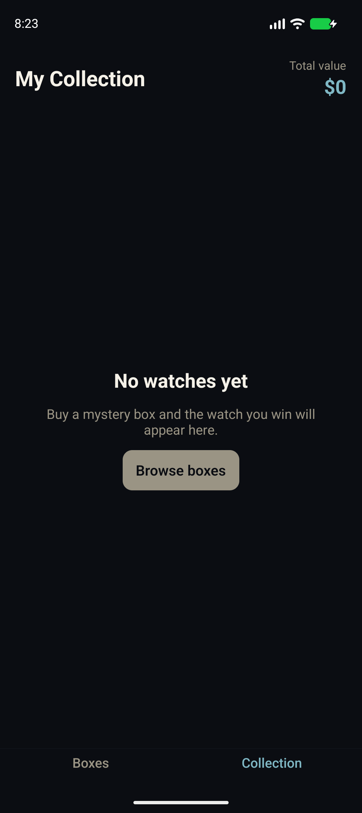
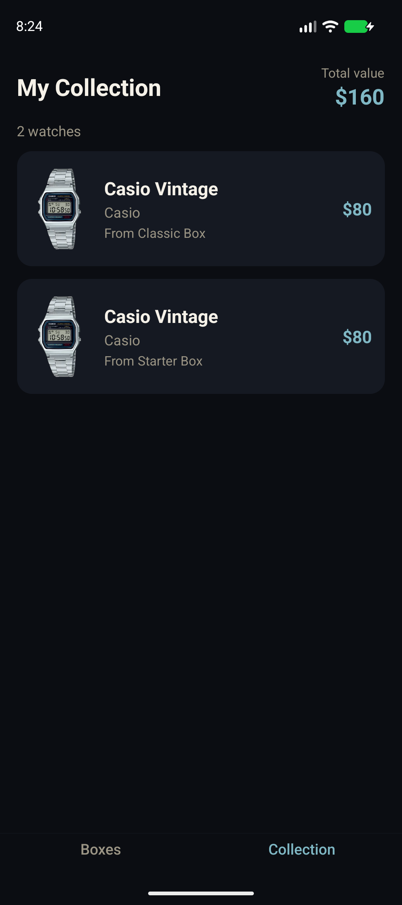
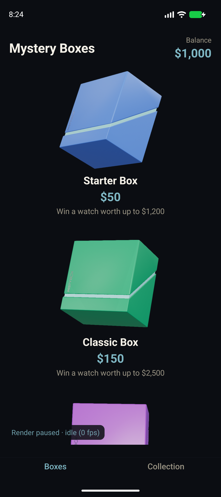
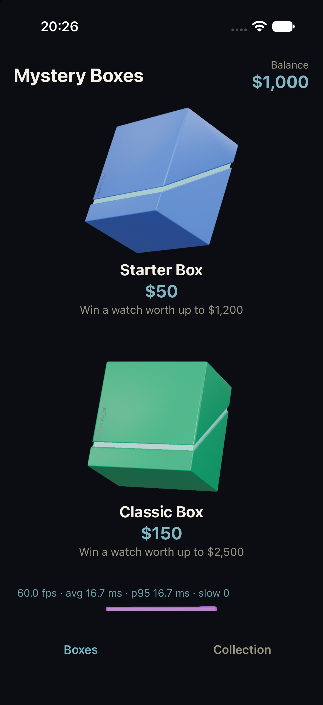
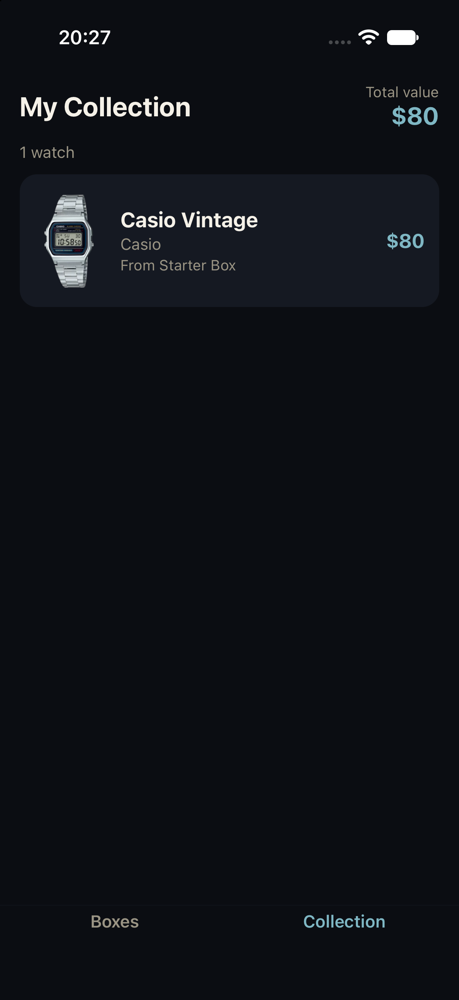

# Collection and navigation

The app has two tabs: **Boxes** (the 3D catalogue with the opening experience) and **Collection** (the watches you won this session).

| Boxes → Collection tab, empty | Collection with two watches | Back on the Boxes tab (3D still alive) |
|---|---|---|
|  |  |  |

iOS:  

## What it does
- **Bottom tabs** (React Navigation 7), themed like the rest of the app, text labels from the translation file.
- **Collection screen:** same header as the catalogue (title on the left, one labelled figure on the right: *Total value*), a count ("1 watch" / "2 watches"), then a list of the won watches, **newest first**: thumbnail, name, brand, value and which box it came from. Duplicates are separate rows.
- **Empty state:** "No watches yet" with a **Browse boxes** button that switches to the Boxes tab.
- The collection is session-scoped (a restart starts empty, as the assignment asks). One successful purchase = one new row.

## Decisions worth knowing
- **One 3D canvas, kept alive.** The catalogue holds the app's only Filament scene (Android draws just one). The tab navigator is created with `detachInactiveScreens={false}`, so the catalogue screen stays attached while the Collection tab is shown and the surface is not destroyed and recreated on every switch. Verified on Android: the boxes are there immediately after coming back.
- **The tab bar keeps its place during the opening** (it is invisible, and cannot be tapped, while a prize is shown), so the viewport and the 3D placement never change mid-animation.
- **Thumbnails in the list**, full images only in the reveal (`utils/watchImageSources.ts`).
- **Shared header** (`components/ScreenHeader`) replaced the catalogue-only balance header, so both tabs look the same.

## Where the code is
`src/navigation/` (types, `TabNavigator`, container + theme), `src/flows/collectionFlow/` (`_facades/useCollectionFacade`, `_adapters/useAdapterCollectionItems`, `_facadesLogic/computeCollectionValue`, `screens/CollectionScreen`).

## Tests
`yarn test`: the adapter (order, formatting, box name, duplicates, nothing invented while boxes load), the facade (empty state, count with singular/plural, total value, "Browse boxes" navigates), the tab labels, the total value maths.

## Manual checks done
| Check | Android | iOS |
|---|---|---|
| Empty collection + Browse boxes → Boxes tab | ✅ | ✅ |
| Buy two boxes, both appear (newest first), total value | ✅ | ✅ (one) |
| 3D boxes visible after switching tabs | ✅ | ✅ |
