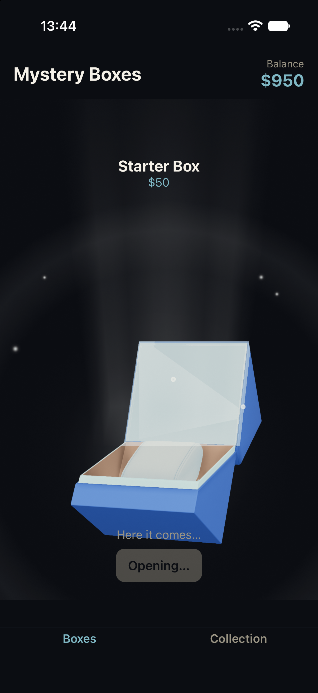
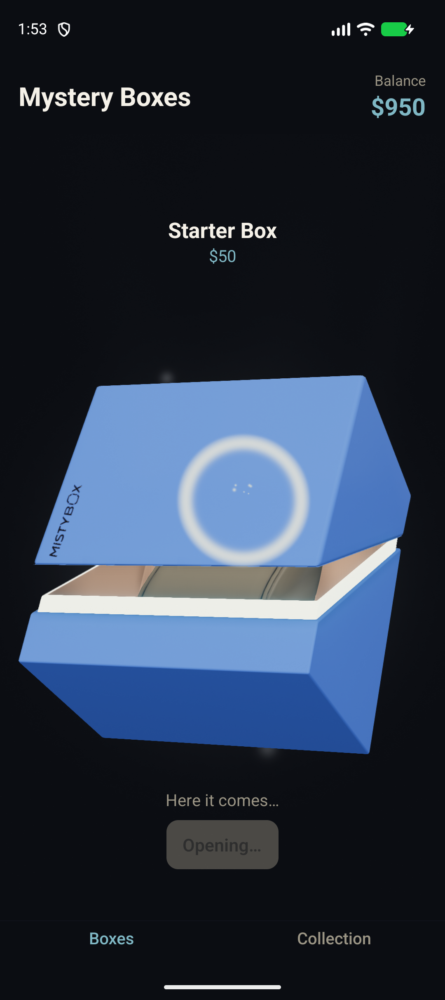

# The show around the box

Everything that happens in the 3D scene besides the box itself: the light in the seams, the light curtain, the shock waves, the sparks, the dust, the glow behind every box, the camera punch and the little physical touches. The look is the same in all three repositories; the numbers are one configuration file, [`effectsConfig.ts`](../src/flows/openingFlow/_config/effectsConfig.ts), and the maths is one pure file, [`computeSceneEffects.ts`](../src/flows/openingFlow/_facadesLogic/computeSceneEffects.ts) (unit tested, no engine in it).

Left: iOS, the light curtain rises from the open box. Right: Android, the shock wave and the sparks at the moment the lid is let go.

 

## Timeline of an opening

| Moment | What you see | Where |
|---|---|---|
| Box bought | The coloured trim of the seam starts to **breathe** softly in the colour of the prize. The box is now "armed". | `computeSeamIntensity` |
| Finger held on the box for 0.45 s (or *Open the box* / swipe up) | The opening starts. | `useOpeningFacade` |
| 0 – 0.8 s anticipation | The box shakes and swells, the seams light up stronger and stronger, faint motes behind the box are **drawn in** towards it, the haptic engine pulses denser and harder. | `computeSeamIntensity`, `computeDustPoint`, `ANTICIPATION_HAPTIC_PULSES_MILLISECONDS` |
| last 0.14 s | The box **holds its breath**: the shake dies away. | `computeJitterScale` |
| Lid let go | **Camera punch** (the box swells and shakes for a moment), the seams **flash**, **shock waves** and a **burst of sparks** leave the box, the **light curtain** rises. | `computeCameraPunch`, `computeRingEffect`, `computeBurstParticle`, `computeShaftEffect` |
| Lid open | The lid swings a little past the open position and **settles**. | `computeLidSettleDegrees` |
| Prize shown | The light curtain rises from the open box to the watch; the watch floats, slides against the tilt of the phone and glints. | `computeShaftEffect`, `useFacadeWatchReveal` |
| Box put away | Everything fades with the box. | `tuckProgress` in every function |

Outside an opening: a soft coloured **glow behind every box** (the colour of the box), and the boxes **sway against the direction of a fast scroll** (`stepScrollSway`).

## The better the prize, the bigger the show

| Rarity | Sparks | Shock waves | Light curtain (strength / height) | Seam and light boost | Camera punch |
|---|---|---|---|---|---|
| Common | 6 | 1 | 0.45 / 3.2 | 1.0 | 0.5 |
| Rare | 12 | 1 | 0.65 / 3.2 | 1.2 | 0.7 |
| Epic | 20 | 2 | 0.85 / 3.4 | 1.5 | 0.85 |
| Legendary | 32 | 3 | 1.0 / 3.6 | 2.0 | 1.0 |

## How it is drawn

- Three tiny pre-built shapes, all flat, facing the (fixed) camera, unlit, alpha blended: a soft **disc** (sparks, dust, glow behind a box), a thin **ring** (shock wave) and a **curtain** (the light). Pools of them are re-used; nothing is created while the app runs.
- The soft edges come from a small **alpha texture** in each model (`scripts/assets/generateEffectModels.mjs` writes `src/assets/models/fx_*.glb`). Filament ignores vertex alpha on Android, so a texture is the portable way.
- The sparks, the shock waves and the light curtain are drawn **in front of the open box** so no wall of the box cuts them off; the dust and the glow are **behind** the box, so nothing ever flies through the figure.
- The coloured trim of the seam is the box model's own `Shell_Seam` accent material; the show makes it emissive.
- Everything is tinted with the colour of the prize (`glowColorLinear`, multiplied by the rarity boost) and fades with `baseColorFactor`.

## Look of the scene

- **Vignette.** A soft dark vignette ([`SceneVignette`](../src/components/SceneVignette/SceneVignette.tsx), a stretched alpha PNG written by `scripts/assets/generateVignette.mjs`) lies over the 3D scene and under the texts of the list: it darkens the corners and pulls the eye to the middle. It is an image over the scene, not an engine effect, so it is identical on both platforms and costs nothing per frame.
- **Iridescence.** The glossy boxes (metallic finish from 0.25 up, i.e. the three dearest) shimmer: a colour shift (gold → magenta → cyan, at most 0.16 in linear RGB) is added to the base colour and moves with the turn of the box, so it plays while you scroll or turn the box. `getIridescenceStrength` and `computeIridescenceTint` in `computeSceneEffects`. It is a colour shift of the base colour, **not** a thin-film material: Filament's glTF loader does not confirm `KHR_materials_iridescence`, and one approach had to work on all engines.
- **Depth-of-field look.** The faint motes behind the box are drawn bigger and softer the deeper they float (a circle of confusion, as bokeh). There is **no full-screen depth-of-field pass**: the scene has one box in focus and an empty dark background, so the pass would show almost nothing and would cost frames.
- **Colour grading: not done in this repository.** `react-native-filament` exposes bloom, ambient occlusion and dynamic resolution, but not `ColorGrading`; adding it means patching the vendored native code. The native repository does grade (see its `EFFECTS.md`).

## Interaction

- **Hold a finger on a bought box** for 0.45 s: it charges and opens (an alternative to swiping up).
- The haptic engine pulses along the anticipation (light → heavy).
- The watch of the reveal slides against the tilt of the phone and catches the light now and then.

## Ideas not done

A full-screen depth-of-field pass and lens flare (cost frames, little to show in this scene); a thin-film iridescent material (not confirmed in Filament's glTF loader); a 3D collection shelf.
