# Performance

> **Result in one sentence:** the 3D mystery-box scene runs at a steady **60 FPS on both iOS and Android**, with **0 slow frames**, from 1 box up to **64 boxes (2 million triangles)**, in every quality profile.

> **Before you measure anything, read the rules in [TESTING.md](TESTING.md#2-the-golden-rules).** The most important one: **run only one platform at a time**: either the Android emulator with the iOS simulator shut down, or the iOS simulator with the Android emulator shut down. They share the Mac's GPU and CPU, so running both produces false jank and unusable numbers. Use a **release** build, and do not trust a freshly booted emulator for the first minute.

This page explains what was measured, how, what keeps the app at 60 FPS, and how to repeat the tests with one command.

- [1. The numbers](#1-the-numbers)
- [2. What it looks like](#2-what-it-looks-like)
- [3. How we measure](#3-how-we-measure)
- [4. Android: emulator window and graphics backend](#4-android-emulator-window-and-graphics-backend)
- [5. What keeps it fast](#5-what-keeps-it-fast)
- [6. CPU and memory](#6-cpu-and-memory)
- [7. Run the tests yourself](#7-run-the-tests-yourself)
- [8. Honest limits](#8-honest-limits)
- [9. Raw data](#9-raw-data)

---

## 1. The numbers

Each scenario runs for 30 seconds while the box lid swings open and closed non-stop (so the renderer never gets to rest). The first 12 seconds of every scenario are thrown away (shaders compile, the model loads). All builds are **release builds**. Only **one** simulator/emulator was running at a time, because they share the Mac's GPU and disturb each other.

| Scenario | Triangles on screen | iOS Simulator | Android Emulator |
|---|---|---|---|
| 1 box | 31 thousand | **60.0 FPS**, 0 slow frames | **60.0 FPS**, 0 slow frames |
| 4 boxes | 125 thousand | **60.0 FPS**, 0 slow frames | **60.0 FPS**, 0 slow frames |
| 16 boxes | 500 thousand | **60.0 FPS**, 0 slow frames | **60.0 FPS**, 0 slow frames |
| 64 boxes, full quality | 2.0 million | **60.0 FPS**, 0 slow frames | **60.0 FPS**, 0 slow frames |
| 64 boxes, balanced quality | 2.0 million | **60.0 FPS**, 0 slow frames | **60.0 FPS**, 0 slow frames |
| 64 boxes, performance quality | 2.0 million | **60.0 FPS**, 0 slow frames | **60.0 FPS**, 0 slow frames |

In every row: the slowest single frame was **17 ms** and 95 % of frames took **16.7 ms** or less. 16.7 ms is exactly one frame of a 60 Hz screen, so this is the best a 60 Hz screen can show.

A "slow frame" is any frame that took longer than 25 ms (a visibly missed refresh).

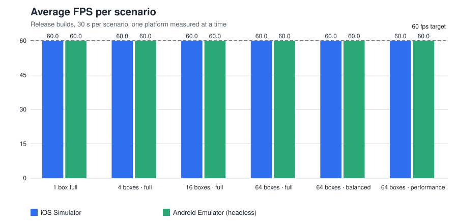

**The real catalogue screen** (8 boxes in a scrolling list, one shared 3D scene) was measured too, with the list scrolling by itself for 60 s: **60.0 FPS on iOS and on Android, 0 slow frames, worst frame 17 ms** (details in [CATALOGUE.md](CATALOGUE.md)).

**Finished app:** catalogue scrolling for 60 s gives **60.0 FPS on both platforms, 0 slow frames** (iOS and Android, 51 one-second windows each; Android also confirmed by SurfaceFlinger: 600 frames in 10 s). Background → foreground keeps 60 FPS (no duplicated frame loops). Opening flow on Android: 59.6 FPS average, min 58 (the screenshots taken during the flow cost a few frames).

**With lights, shadows, ambient occlusion and bloom on:** the catalogue scrolls for 60 s at **60.0 FPS with 0 slow frames, worst frame 17 ms, on iOS and on Android** (51 one-second windows each). The Android emulator **window** was measured as well, scrolling the list non-stop with the release build: **60 FPS for 30 s, twice (1800 presented frames each, counted by SurfaceFlinger)**, at the default size and at `-scale 0.6 / 0.7 / 0.85 / 1.0`. The one slower reading (43 FPS) came right after a cold emulator boot and did not come back.

The Android result was reproduced three times, including once on the final code after the code review, and cross-checked with a second, independent counter (see section 3): **600 frames presented in 10 s = 60 FPS**.

---

## 2. What it looks like

Real screenshots taken by the test script while each scenario was running. The text at the top is the live FPS meter built into the app.

### iOS (iPhone 17 Simulator, iOS 27)

| 1 box | 4 boxes | 16 boxes |
|---|---|---|
| 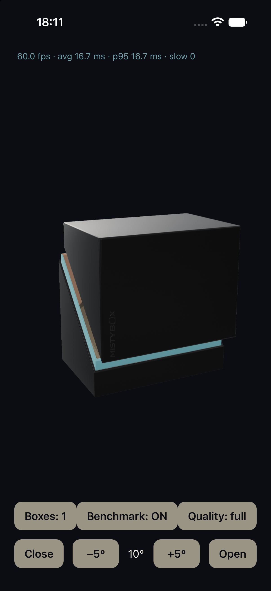 | 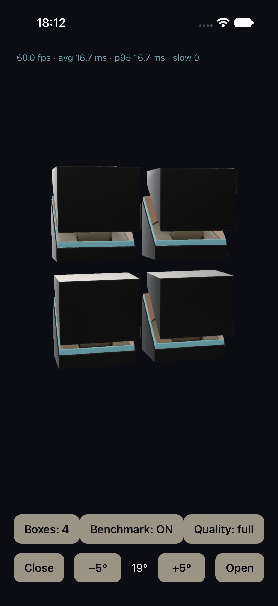 | 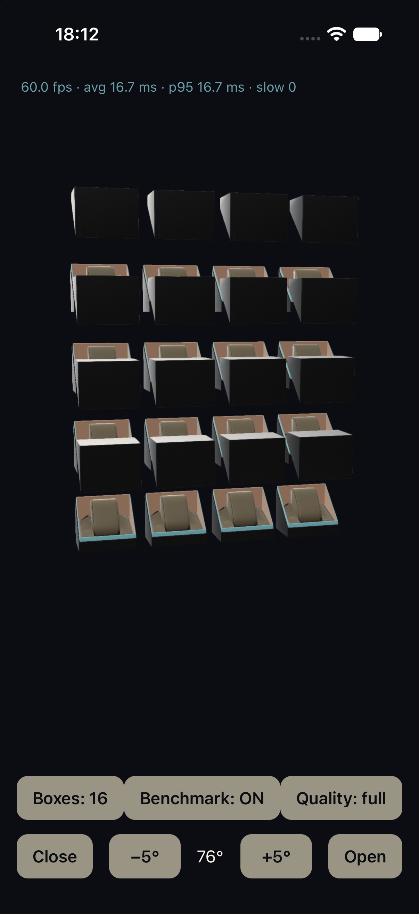 |

| 64 boxes, full | 64 boxes, balanced | 64 boxes, performance |
|---|---|---|
| 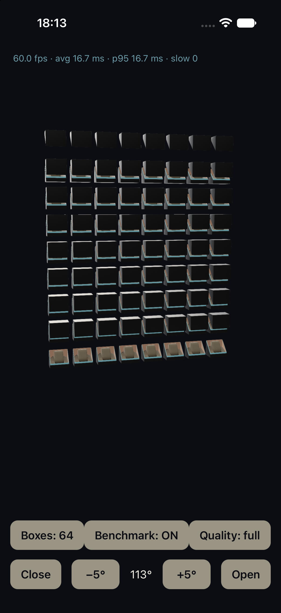 | 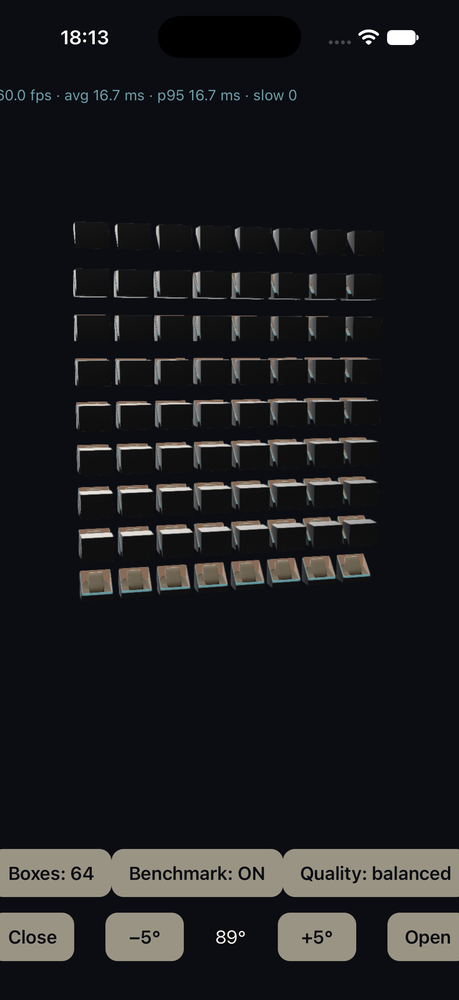 | 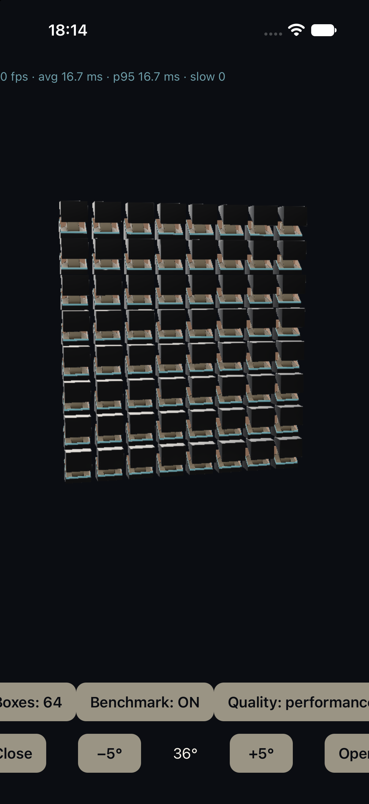 |

### Android (Pixel 9 profile, API 37 Emulator)

| 1 box | 4 boxes | 16 boxes |
|---|---|---|
| 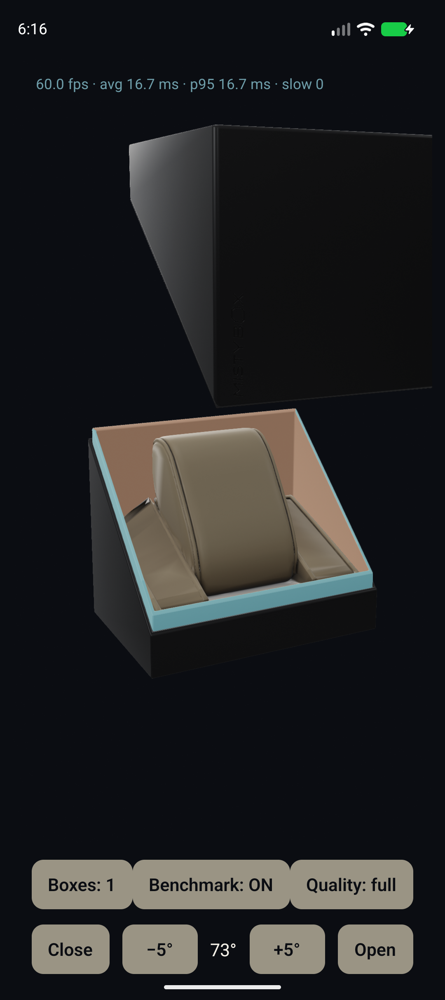 | 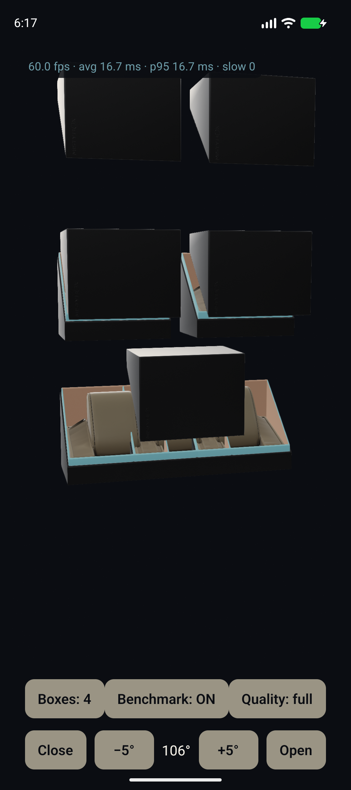 | 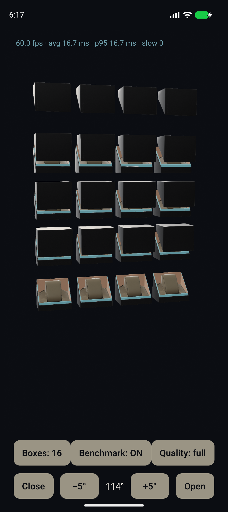 |

| 64 boxes, full | 64 boxes, balanced | 64 boxes, performance |
|---|---|---|
| 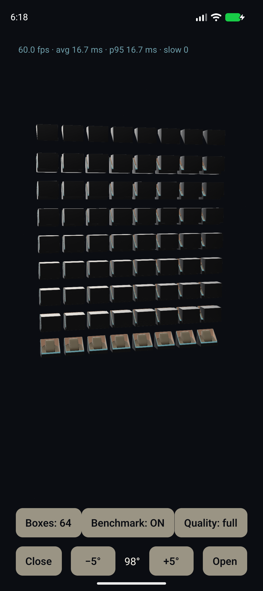 | 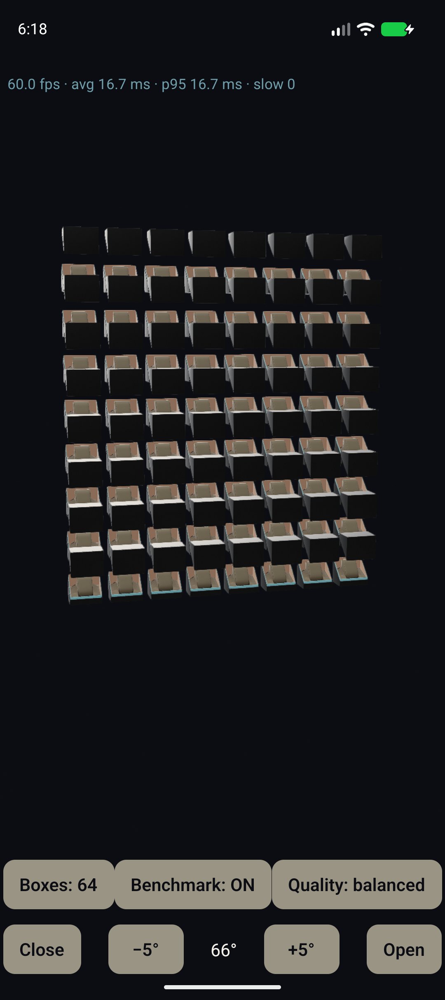 | 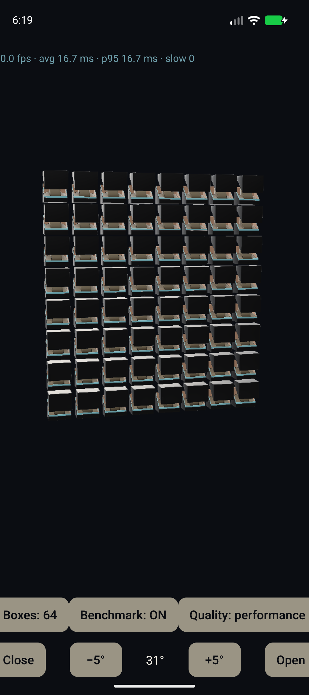 |

---

## 3. How we measure

There is no single FPS number that a phone hands you, so we use **three different tools** that look at the problem from different sides. If they agree, we trust the result.

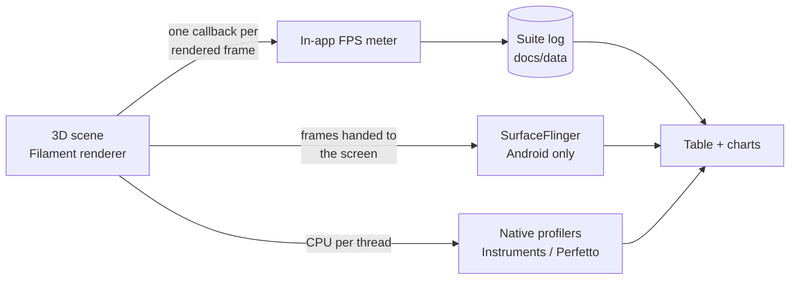

### 3.1 The in-app FPS meter (both platforms)
The renderer calls our code once for **every frame it draws**. We record the time between calls. Every second we compute: average FPS, average and 95th-percentile frame time, the slowest frame, and the number of slow frames. It prints a line like `[perf:android] {...}` and shows the same numbers on screen. Because it is the same code on iOS and Android, the two platforms are directly comparable.

### 3.2 The benchmark suite (both platforms)
A special build (`EXPO_PUBLIC_AUTO_BENCHMARK=suite`) walks through the six scenarios by itself, 30 seconds each, and tags every report with the scenario name. One command (`yarn perfIosSuite` / `yarn perfAndroidSuite`) restarts the app, collects ~200 s of data, takes one screenshot per scenario and prints the table above.

### 3.3 Independent cross-checks
| Tool | Platform | What it tells us | Command |
|---|---|---|---|
| SurfaceFlinger `--timestats` | Android | How many frames the system actually **put on the screen** (not just rendered) | `yarn perfAndroidPresentFps` |
| Perfetto system trace | Android | CPU per thread, buffer-queue stalls | `yarn perfAndroidTrace` |
| Instruments (Time Profiler) | iOS | CPU per thread | `yarn perfIosProfile` |

Things that look useful but are **not** reliable for this app: `dumpsys gfxinfo` only sees the normal Android UI thread, and the 3D scene draws on its own thread, so it reports almost nothing. Do not read FPS from it.

---

## 4. Android: emulator window and graphics backend

**The emulator window is not a limit.** The finished app scrolls at 60 FPS in the emulator window too (SurfaceFlinger count, section 1). Headless (`-no-window`, `yarn androidEmulatorStart`) is still the reference for exact numbers, because there is no window compositing to disturb them, and a freshly booted emulator reads lower for about a minute. Running the iOS Simulator and the Android Emulator at the same time slows both (one shared GPU), so one platform is measured at a time.

### Android backend: Vulkan (default) or OpenGL ES

On a cold emulator the first catalogue frame with Filament's own pick (OpenGL ES, translated by the emulator) shows the list with **no boxes for 10 to 15 s**: the glTF shaders are still compiling. Creating the engine with the Vulkan backend removes it. `FilamentScene` takes a `backend` prop (`createEngine('vulkan')`), so repo 1 can do the same.

Result with Vulkan: the boxes are on screen with the first list frame (about 1.8 s after launch on a cold emulator, 3 s screenshot shows them), and the catalogue scrolls at **60 FPS in every window, headless and in the emulator window** (in-app overlay: 60.0 fps, p95 16.7 ms, slow 0; `dumpsys SurfaceFlinger --latency` of the app layer: 60.0 presented FPS in six consecutive 1-second samples, after the boxes were up for 45 s). Log line confirming the backend: `FEngine resolved backend: Vulkan`.


Decision: Vulkan is the default on Android (`src/flows/catalogueFlow/_config/sceneRenderConfig.ts`); `EXPO_PUBLIC_ANDROID_BACKEND=opengl` switches back to Filament's pick. Not tested: a physical Android phone, where the emulator's translation layers do not exist (OpenGL ES may well compile fast there, Vulkan support depends on the device). The raw log of the headless Vulkan run is `docs/data/android-catalogue-scroll-vulkan-headless.log`.

---

## 5. What keeps it fast

Most of the work was making sure the app does **less**, so 60 FPS stays cheap.

| # | Change | Why it helps | Measured effect |
|---|---|---|---|
| 1 | **One 3D scene for everything** | A second 3D view on Android never draws (library limit). One scene works the same on both platforms. | Fixed a blank-screen bug |
| 2 | **Load the box model once, draw it N times** (instancing) | Before, every box loaded its own copy of the model. | 64 boxes: no more per-box model copy |
| 3 | **Compressed 3D model** (Draco) | Smaller file, faster start. Looks identical. | `box.glb` 1.32 MB → **157 KB** (−88 %) |
| 4 | **WebP watch images** (full size + small thumbnails) | Lists no longer decode 6 MB pictures. | Images 5.2 MB → 660 KB; thumbnails 104 KB (−98 %) |
| 5 | **Render on demand** | A still scene does not need 60 redraws a second. The renderer is switched off when nothing moves and back on when something changes. | Idle CPU: iOS 0.5 %, Android 0.02 cores; saves battery |
| 6 | **Quality profiles** (full / balanced / performance) | Lets us lower anti-aliasing, shadows and resolution on weak devices. | All three hold 60 FPS here, so there is headroom |
| 7 | **arm64-only Android build** | Ships one CPU architecture instead of four. | Release APK **36.4 MB** |
| 8 | **Guards around a library start/stop bug** | See below. | Removed FPS counts of 111–255 (frame loops that multiplied) |

### A library start/stop bug the app works around
On Android, `FilamentChoreographer.stop()` cannot cancel the frame that is already queued. If `stop()` and `start()` happen within one frame, **two frame loops run forever** and the frame rate doubles, triples and so on (the counter then shows 111–255 "FPS"). We cannot (and by project rule do not) patch the library, so the render-on-demand code:
- never calls `start()` on something that is already running,
- keeps `stop()` and the next `start()` at least 300 ms apart,
- has a *continuous* mode that never stops (used while the benchmark animates).

The logic is covered by unit tests (`useFacadeRenderOnDemand.test.ts`).

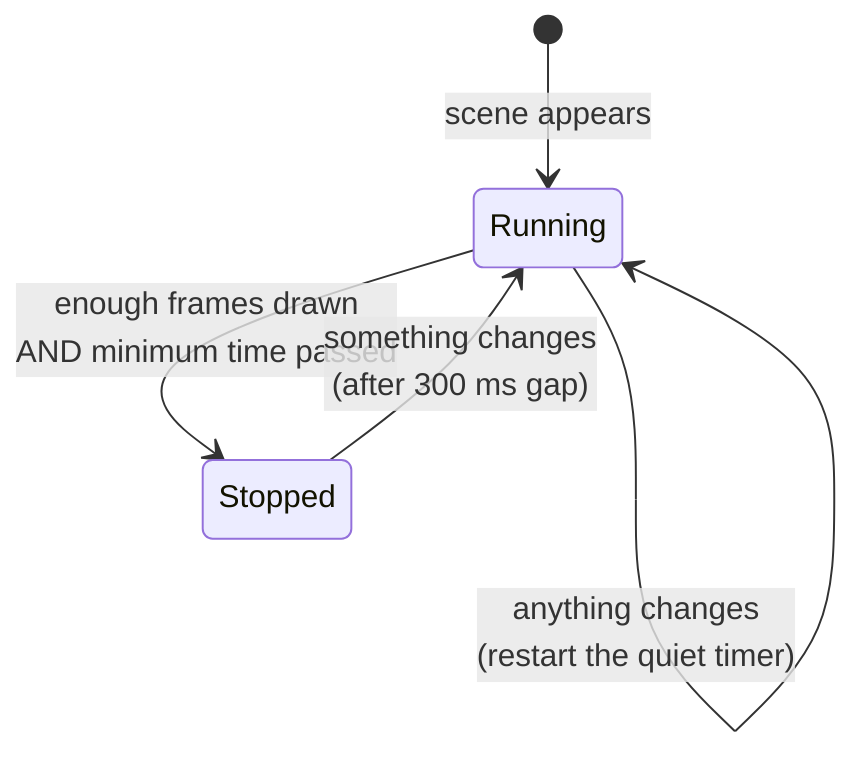

---

## 6. CPU and memory

**CPU while the scene is open (1 box, steady state)**

| Platform | What | Cost |
|---|---|---|
| iOS | Rendering threads | ≈ 9 % of one core |
| iOS | Main thread / JS thread | ≈ 2 % / ≈ 1 % |
| Android | Rendering thread (`FEngine::loop`) | ≈ 19 % of one core (windowed emulator trace) |
| Android | JS thread | ≈ 3 % |

The 3D work runs **off the UI and JavaScript threads**, so the mock API, state and navigation have plenty of room.

**Memory**

| Build | Measurement | Value |
|---|---|---|
| Android release, 64 boxes (end of suite) | PSS | ≈ 139 MB |
| iOS Simulator debug, 1 → 64 boxes (before instancing) | RSS | 582 MB → 824 MB |

Memory numbers differ a lot between debug and release builds, so compare only like with like.

---

## 7. Run the tests yourself

Run **one platform at a time**, and read [TESTING.md](TESTING.md) for the full rules (one platform at a time and why, release builds only, headless Android for exact numbers, benchmark builds are not for handing out).

| To test… | Shut this down first | Then |
|---|---|---|
| Android | the iOS Simulator: `xcrun simctl shutdown all` | `yarn androidEmulatorStart` and the Android commands below |
| iOS | the Android emulator: `adb emu kill` | boot the simulator and the iOS commands below |

Why: both run on the same Mac and share its GPU and CPU. With both open, frames are delivered late and unevenly (false jank), so the numbers would not mean anything. Check with `adb devices` and `xcrun simctl list devices booted` that only one device is running.

### Android
```bash
yarn androidEmulatorStart        # boots the emulator headless
yarn androidRunSuite             # builds a release app that runs the 6 scenarios (first time / after code changes)
yarn perfAndroidSuite            # restart, collect ~200 s, screenshots, table
yarn perfAndroidPresentFps       # independent check via SurfaceFlinger
yarn perfAndroidTrace            # Perfetto trace (CPU per thread)
yarn androidEmulatorStop
```
Tip: if `androidRunSuite` seems to use old JavaScript, delete `android/app/build/generated/assets/createBundleReleaseJsAndAssets` and `android/app/build/intermediates/assets/release`, then run it again (Gradle does not track environment variables).

### iOS
```bash
yarn iosRunSuite --device "iPhone 17"   # builds a release app that runs the 6 scenarios
yarn perfIosSuite                       # restart, collect ~200 s, screenshots, table
yarn perfIosProfile                     # Instruments Time Profiler
```

### Charts
```bash
yarn perfCharts                         # redraws docs/media/chart-*.svg from docs/data
```

### Options (environment variables)
| Variable | Meaning |
|---|---|
| `EXPO_PUBLIC_AUTO_BENCHMARK=1` | Swing the lid continuously |
| `EXPO_PUBLIC_AUTO_BENCHMARK=suite` | Walk through all six scenarios by itself |
| `EXPO_PUBLIC_AUTO_BOXES=1\|4\|16\|64` | Start with this many boxes |
| `EXPO_PUBLIC_PERF_SINK_URL` | Send FPS reports to a local collector (iOS release builds do not show their log) |
| `EXPO_PUBLIC_INITIAL_SCREEN=spike` | Start the benchmark lab instead of the catalogue |
| `EXPO_PUBLIC_AUTO_SCROLL=1` | Catalogue scrolls by itself |
| `EXPO_PUBLIC_SHOW_PERFORMANCE=1` | Show the live FPS overlay on the catalogue |
| `ANDROID_ARCHITECTURES` | CPU architectures to build (default `arm64-v8a`) |

---

## 8. Honest limits

- These are **simulator/emulator** results on an Apple M5 Pro. Their GPU is much faster than a phone GPU. The results prove that our pipeline (one scene, hinge animation, JS/worklet threads) is **not** the bottleneck; they do not prove that every phone reaches 60 FPS at 64 boxes. The real catalogue shows only a handful of boxes at once, far below the 64-box stress case.
- The Android emulator **window** holds 60 FPS with the finished app (30 s, twice), but a freshly booted emulator reads lower for about a minute. Headless stays the reference for exact numbers.
- The reveal (flash, particles, pulsing circles, put-away animation) was not measured separately; the catalogue scroll was measured after the polish.
- No physical iPhone or Android phone was measured. The same scripts work on a real device unchanged.
- `react-native-filament` 2.0 is an unreleased release candidate (vendored and pinned, see `vendor/react-native-filament/VENDOR.md`).
- Our render-on-demand code remembers whether the renderer is running. A background → foreground test on both platforms showed no problem (frame rate stays ≤ 60 FPS, the scene is intact), but it is still an assumption about the library; re-check on a real device.
- One iOS Simulator screenshot (taken with `simctl` while the list was scrolling) showed a box torn in two horizontal halves. Six more screenshots of the same scene were clean and the meter reported no slow frame, so it looks like a capture artifact (the screenshot grabbed the Metal layer mid-update); it has not been seen on screen and is untested on a real device.

---

## 9. Raw data

| File | Content |
|---|---|
| [`data/ios-suite.log`](data/ios-suite.log) | Every 1-second report from the iOS suite run |
| [`data/android-suite.log`](data/android-suite.log) | Every 1-second report from the Android suite run |
| `media/*.png`, `media/*.svg` | Screenshots and charts used above |

## The show around the box: FPS with every effect on

Measured with the finished app and everything in [EFFECTS.md](EFFECTS.md) switched on, release builds, one platform at a time, with the in-app meter (`EXPO_PUBLIC_SHOW_PERFORMANCE=1`). Android: [`scripts/perf/measureAndroidFlow.sh`](../scripts/perf/measureAndroidFlow.sh) (16 s warm-up, 35 s of list flings, then select, turn, buy, open, reveal, Done). iOS: the list scrolls by itself (`EXPO_PUBLIC_AUTO_SCROLL=1`), the opening is driven by taps; the meter posts to a local collector (`EXPO_PUBLIC_PERF_SINK_URL`).

| Platform | Scenario | Result |
|---|---|---|
| Android Emulator (headless), release | Catalogue, 35 s of list flings | 60.0 FPS, 32 of 32 windows at 60, 0 slow frames, worst frame 16.7 ms |
| Android Emulator (headless), release | Opening flow (select, turn, buy, open, reveal) | 59.8 FPS, 11 of 12 windows at 59 or more (lowest 58.0), 2 slow frames, worst frame 33 ms |
| iOS Simulator (iPhone 17), release | Catalogue, 60 s auto-scroll | 60.0 FPS, 37 of 37 windows at 60, 0 slow frames |
| iOS Simulator (iPhone 17), release | Opening flow | 60.0 FPS, 9 of 9 windows at 60, 0 slow frames |

What it took to get here: effect materials are drawn once, tiny, in the first 3.5 s (they are compiled during the entrance, not as a hitch of 50 ms when the lid is let go).

The few slow frames left on Android are single frames (33-50 ms) at the moments when React mounts or unmounts a screen (selecting a box, the reveal, Done): the frame loop shares the main thread with the mount.
