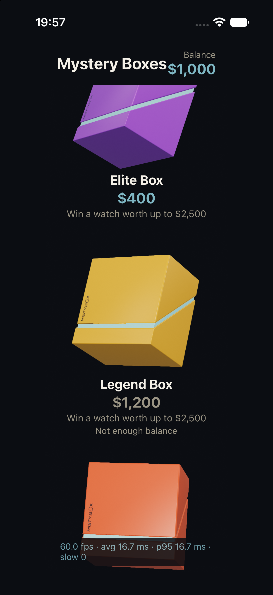
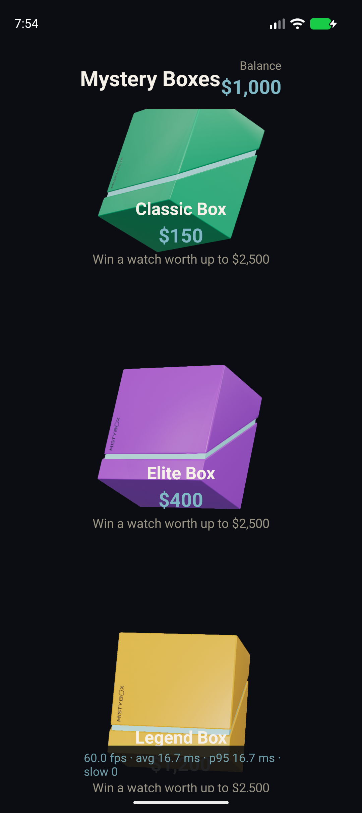
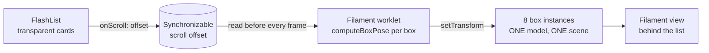

# Stage 3 — Live 3D catalogue

Note: in Stage 6 the box was made a little smaller in its slot (`BOX_SLOT_FILL` 0.72 → 0.64) so that at strong parallax it never touches the card text.

## What you see
A scrollable list of 8 mystery boxes. Every box is a **real-time 3D model**, not an image: it has its own colour, turns a little while you scroll, and shows its price, the best possible prize and (when the balance is too low) "Not enough balance". The balance sits in a header above the list.

| iOS | Android |
|---|---|
|  |  |

## How it works

- **One scene, one 3D canvas** behind the list; the list cells are transparent and have a fixed height, so the position of every card is known without measuring.
- On every scroll event the offset is written into a shared value. Right before every frame the 3D side reads it and places each box in the slot of its card (`computeBoxPose`, a pure function with unit tests). React is not involved per frame.
- One GLB is loaded once and instanced 8 times; each instance gets the colour of its card.
- **Visibility gating:** boxes of cards more than 1.5 cards outside the viewport are parked out of the camera's view.
- **Render on demand:** the renderer runs while the list scrolls (plus a short settle time) and stops when it is idle.

## Where the code is
`src/flows/catalogueFlow/` — `_facades/useCatalogueFacade.ts`, `_adapters/useAdapterCatalogueCards.ts`, `_facadesLogic/{computeBoxPose,convertHexToLinearColor}.ts`, `_config/catalogueLayoutConfig.ts`, `screens/CatalogueScreen/…` (balance header, box card, 3D scene).

## Performance (list scrolling by itself, release builds, 60 s, one platform at a time)
| | iOS Simulator | Android Emulator (headless) |
|---|---|---|
| Average FPS | **60.0** | **60.0** |
| Slow frames | 0 | 0 |
| Worst frame | 17 ms | 17 ms |

Reproduce: `yarn androidRunCatalogueScroll` + `yarn perfAndroidCatalogue`, `yarn iosRunCatalogueScroll --device "iPhone 17"` + `yarn perfIosCatalogue`. Raw data: `docs/data/*-catalogue-scroll.log`.

## Findings worth knowing
- `MaterialInstance.name` is `undefined` in this library build, so boxes are coloured by part name (`Shell_Base`, `Shell_Lid`) and primitive index instead of by material name.
- Material instances are **per instance**: each box can have its own colour from one loaded model.
- `ModelInstance` transform props multiply onto the current transform on every update, so they are not suitable for scroll-driven motion; the scene sets absolute transforms with `transformManager.setTransform`.
- The FPS meter now ignores the first callback after a render pause (it reported a 20 s "frame").

## Not in this stage
Tapping a box, purchase and opening come in Stage 4; tabs and the collection in Stage 5.
