# Stage 4 — Opening experience

> This note describes the **first version** of the opening experience (Stage 4). Stage 7 added anticipation, rarity-based reveals, more gestures, the box being put away and a new layout; those are described in [ANIMATIONS.md](ANIMATIONS.md). The phase machine below is still the one in use, with the Revealed phase now ending after the box is put away and Done appears.

Branch: `feat/stage-4-opening` (on top of Stage 2 + 3).

Tap a box in the catalogue and it flies to the middle of the screen. You can turn it with your finger, buy it, watch the lid open and see which watch you won.

## The flow
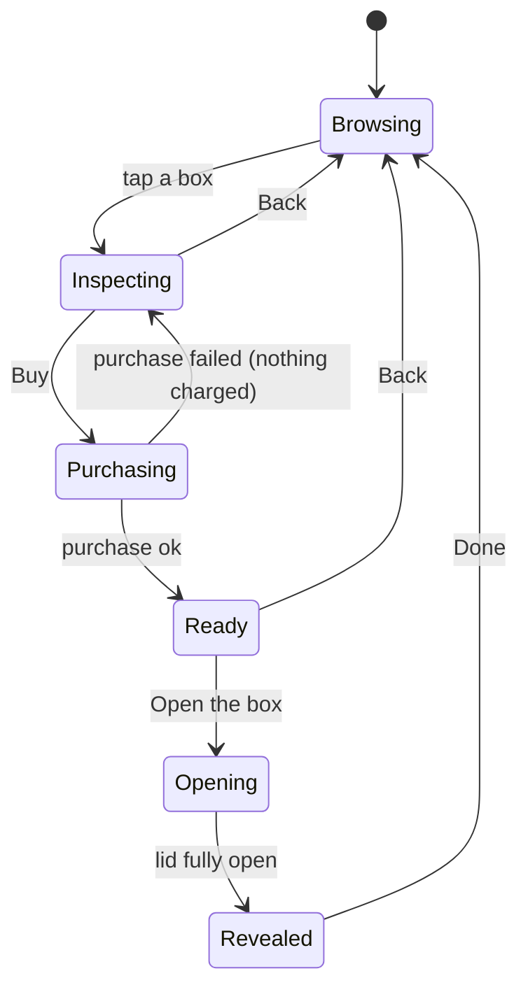
Anything not on the diagram is ignored (a double tap, a late result), so the flow can never end up in a wrong state. You cannot leave while the purchase runs or the lid is opening.

## Screens
| Step | iOS | Android |
|---|---|---|
| Inspect (box centred, drag to turn) | 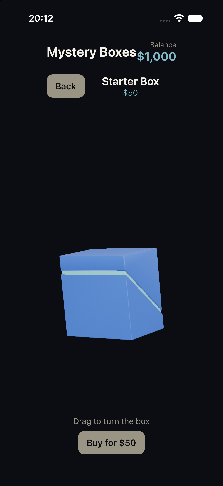 | 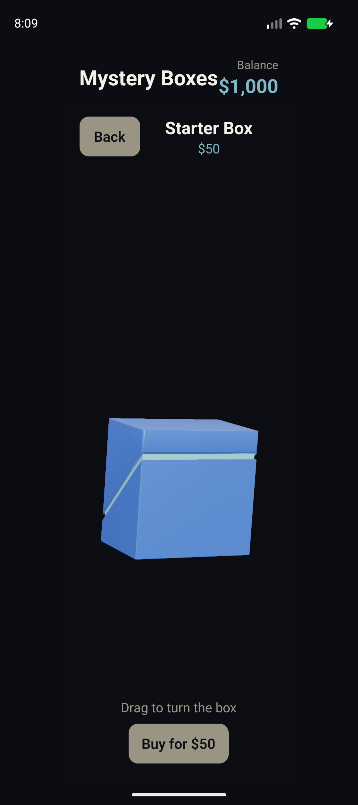 |
| Bought, ready to open | 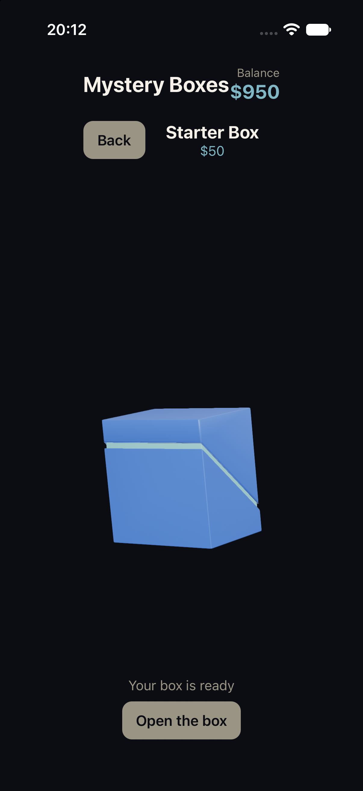 | 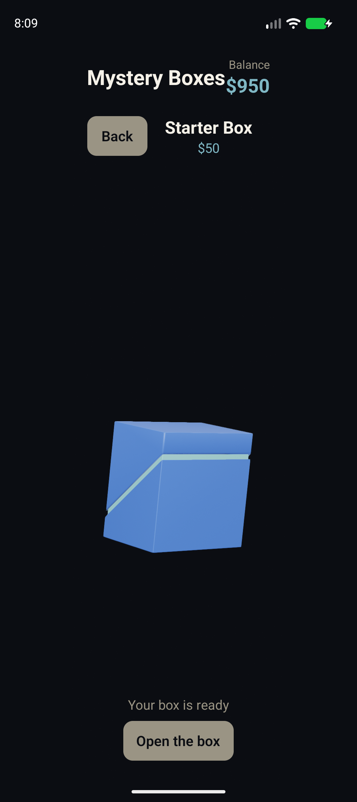 |
| Lid opening | | 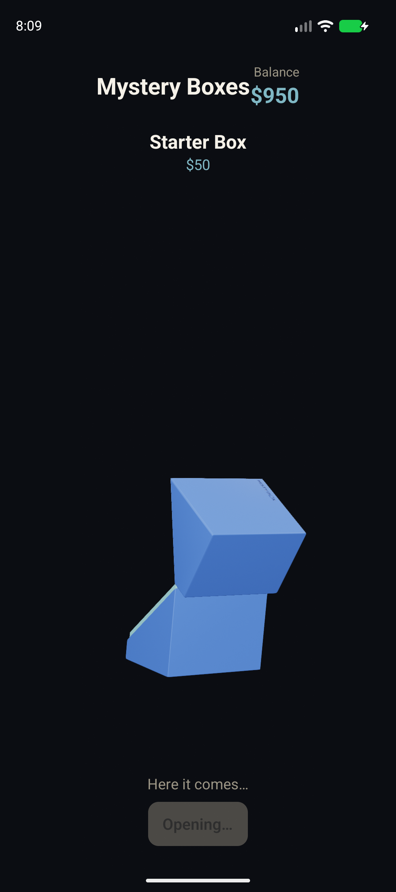 |
| Revealed | 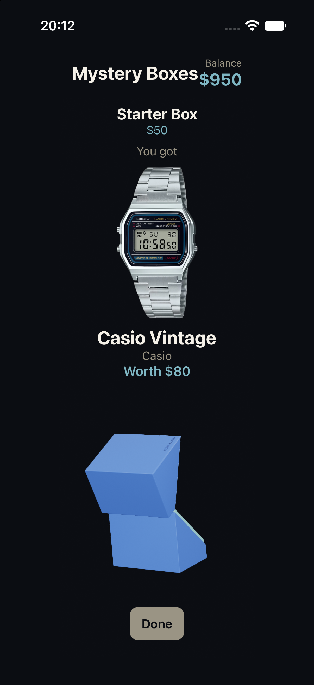 | 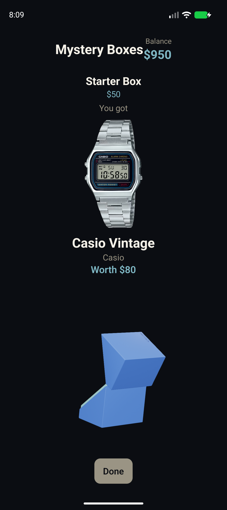 |
| Back in the catalogue (balance updated) | 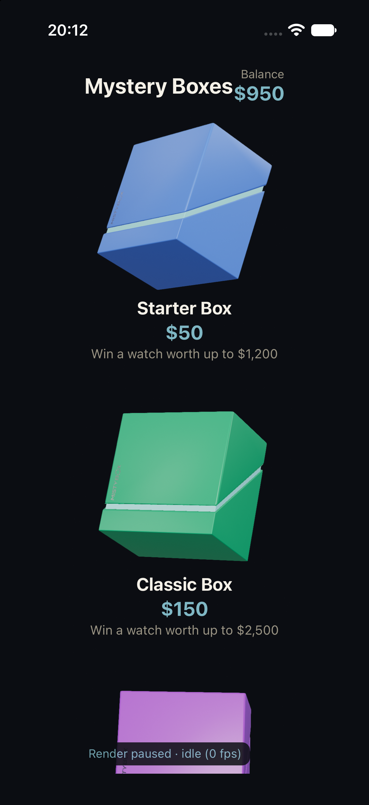 | 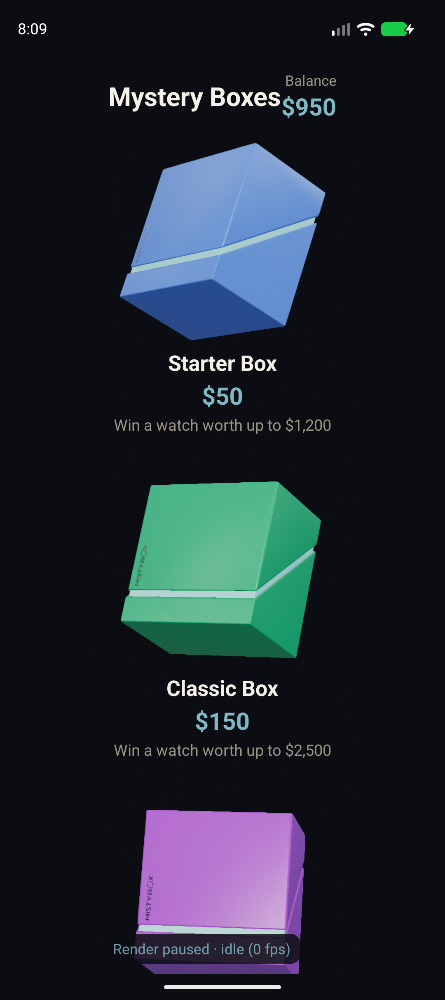 |
| Purchase failed (balance unchanged, try again) | | 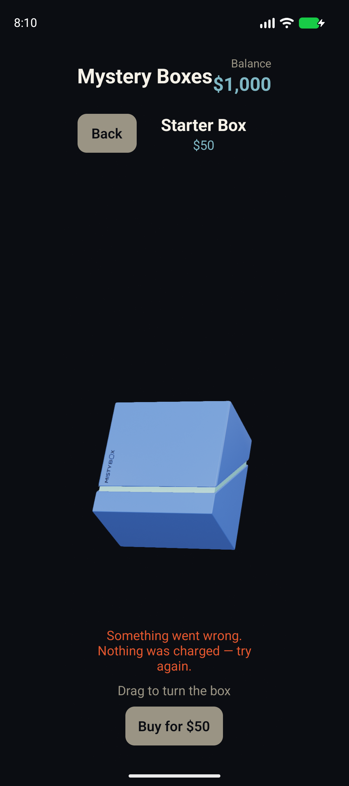 |

## How it works
- **Same 3D scene as the catalogue.** The opened box is one of the catalogue's instances: every frame the scene computes its pose from the list pose and the opening state (`computeOpeningPose`). The other boxes shrink away. No second canvas (Android draws only one).
- **React tells the scene, the scene animates itself.** React writes a small state (`focusedCardIndex`, start times, targets) into a shared value; the 3D side reads it on every frame and computes the progress with easing (`openingSceneState`, `openingEasing`). Reversing mid-way starts from the progress reached so far.
- **Drag to inspect:** a pan gesture (react-native-gesture-handler) writes yaw/pitch into a shared value; after release the box keeps turning with frame-rate independent inertia (`stepDragInertia`), pitch is limited.
- **Lid:** `Shell_Lid` and `Shell_Wordmark` get a hinge matrix about the pivot from `docs/MODEL.md` (0 → 115°) with a small overshoot ("pop").
- **Layout:** closed, the box is big; as the lid opens it shrinks and moves down to leave room for the watch image above it.
- **Reveal:** the watch image (WebP) zooms in over the box, with its name, brand and value.
- **Haptics** (`expo-haptics`, behind `hapticFeedback`): selection, purchase success, error, lid opening.
- **Purchase** reuses Stage 2: one deduction + one watch, only on success, repeated taps ignored, a lost response is retried with the same key. A failed purchase shows why ("Nothing was charged") and the Buy button stays available.
- **Render on demand:** the renderer runs while something moves (scroll, drag, any phase except the revealed picture) and stops when the scene is still.

## Where the code is
`src/flows/openingFlow/` — `_facades/useOpeningFacade.ts`, `_facadesLogic/` (phase machine, easing, scene state, pose, drag inertia, primary action), `_config/`, `screens/OpeningOverlay`. The scene side lives in `src/flows/catalogueFlow/.../useFacadeCatalogueBoxes.ts`. New shared pieces: `components/FadingView`, `services/haptics`, `services/filament/computeLidHingeTransform`.

## Tests
`yarn test` — 131 tests. New: phase machine, easing/progress, scene state, opening pose, drag inertia, primary action, the opening facade end to end (buy → open → reveal → done, failure, unaffordable box, back, scene state written).

## Manual checks done
| Check | Android | iOS |
|---|---|---|
| Select, turn, buy, open, reveal, done | ✅ (scripted: `yarn perfAndroidOpening`) | ✅ |
| Balance −$50 once, one watch | ✅ | ✅ |
| Failed purchase: error shown, balance unchanged | ✅ (`EXPO_PUBLIC_MOCK_PURCHASE_FAILURE=serverError`) | covered by unit tests |
| Frame rate through the whole flow | 59.6 avg, min 58, worst frame 50 ms (the screenshots themselves cost frames on the emulator) | 60.0 on screen |

## Not done / next
- The camera and the light are fixed; the "dolly" is done by moving and scaling the box.
- Tapping a box in the "Not enough balance" state opens it, but Buy is disabled.
- Tabs and the collection screen come in Stage 5; the won watch is already stored in the collection store.
